# Dokumen Teknis ARTA-C Portable v2

**Dispenser obat TB pintar dengan pemantauan Pengawas Menelan Obat (PMO)**

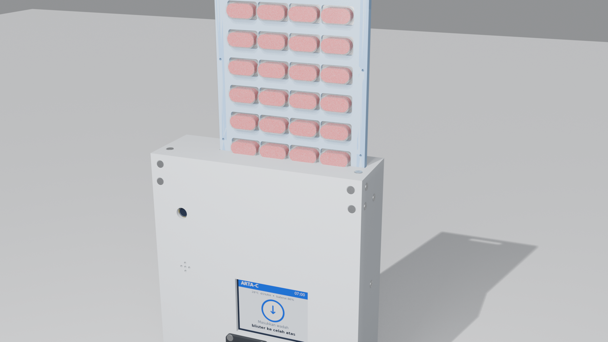

| | |
|---|---|
| No. dokumen | ARTAC-DT-001 |
| Revisi | 1.0 |
| Tanggal | 27 Oktober 2026 |
| Status | Prototipe (desain siap cetak, belum diuji fisik) |
| Disusun oleh | Tim ARTA-C |

<!-- ISI -->

# Daftar isi

1. Ringkasan
2. Spesifikasi teknis
3. Arsitektur sistem
4. Desain mekanik
5. Desain elektronik dan daya
6. Firmware dan integrasi aplikasi
7. Cara penggunaan
8. Manufaktur dan perakitan
9. Rencana pengujian dan validasi
10. Analisis risiko dan keselamatan
11. Perawatan dan penanganan masalah
12. Batasan dan pengembangan lanjut
13. Lampiran: daftar part, estimasi biaya, daftar file

# 1. Ringkasan

## 1.1 Latar belakang

Pengobatan tuberkulosis (TB) membutuhkan minum obat setiap hari selama minimal 6 bulan. Paket obat lini pertama di Indonesia berbentuk kaplet kombinasi dosis tetap (KDT/4FDC: rifampisin, isoniazid, pirazinamid, etambutol) dalam blister 28 kaplet. Jumlah kaplet per hari bergantung berat badan pasien (2–5 kaplet).

Putus obat menjadi penyebab utama kegagalan terapi dan munculnya TB resisten obat. Karena itu, setiap pasien didampingi seorang **PMO (Pengawas Menelan Obat)**. Masalahnya, PMO tidak selalu bisa hadir setiap hari.

## 1.2 Tujuan alat

ARTA-C Portable adalah dispenser obat yang:

1. **Mengeluarkan dosis harian secara otomatis** langsung dari **blister obat utuh**. Obat tetap terlindung di kemasan aslinya sampai saat diminum.
2. **Memastikan obat diminum oleh pasien yang benar**: wajah pasien diverifikasi dengan kamera ESP32-CAM sebelum obat dikeluarkan.
3. **Memantau kondisi pasien**: detak jantung dan SpO₂ dibaca lewat sensor PPG di kantong jari. Suhu dan kelembapan ruang simpan obat juga dipantau.
4. **Melaporkan kepatuhan secara daring** ke aplikasi web ARTA-C (dokter, PMO, pasien). Dosis terlewat langsung memicu peringatan.

## 1.3 Konsep "pemanggang roti"

Blister dijepit utuh di dalam **wadah**. Wadah dimasukkan dari celah atas alat dan mula-mula menyembul seperti roti di pemanggang. Alat lalu menurunkan wadah **baris demi baris**. Pada setiap baris, **kereta pelatuk** bergerak kiri–kanan, dan **pelatuk** menekan kubah blister perlahan hingga kaplet menembus foil ke belakang. Kaplet kemudian meluncur ke **baki ambil** di depan bawah.

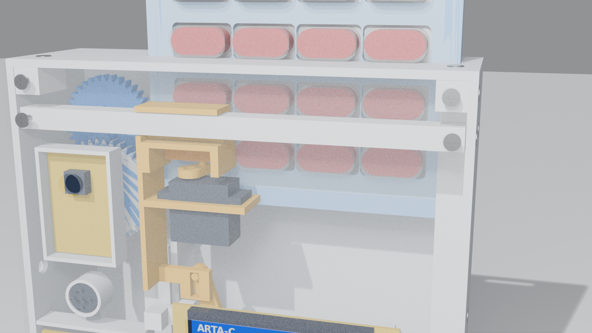

# 2. Spesifikasi teknis

| Parameter | Nilai |
|---|---|
| Dimensi luar (L × T × tebal) | 168 × 206 × 54 mm (96 mm termasuk kantong jari PPG) |
| Massa (perkiraan) | ±750 g (±555 g bagian cetak + ±190 g elektronik dan sekrup) |
| Bahan enklosur | PLA cetak 3D, dinding 3 mm; bagian bergerak PETG |
| Kapasitas | 1 blister 4 × 7 = 28 kaplet (±5–14 hari, tergantung dosis 2–5 kaplet/hari) |
| Ukuran blister yang didukung | ±100 × 150 mm, jarak kantong 24 × 20,5 mm (parametrik, dapat disesuaikan) |
| Mekanisme | 3 servo MG90S: penurun wadah (rack + roda gigi), penggeser kereta (tuas), pelatuk (scotch-yoke) |
| Gaya dorong pelatuk | ≥28 N di seluruh langkah, naik menjelang akhir langkah |
| Langkah wadah | 141 mm (7 baris + posisi masuk/keluar) |
| Pengendali utama | ESP32-2432S028 (CYD), layar sentuh 2,8" 320 × 240, UI LVGL |
| Modul kamera | ESP32-CAM (OV2640), verifikasi wajah dan foto bukti |
| Sensor | MAX30102 (PPG: detak jantung, SpO₂), DHT11 (suhu & kelembapan) |
| Notifikasi | Buzzer aktif 5 V, layar, notifikasi aplikasi |
| Konektivitas | WiFi 2,4 GHz (ke Firebase), ESP-NOW (antar ESP32) |
| Catu daya | LiPo 1S 3,7 V 2000 mAh; pengisian USB-C 5 V lewat IP5306 |
| Daya tahan baterai (perkiraan) | ±12 jam (siaga, layar redup) hingga ±1–1,5 hari (mode hemat: layar mati, ESP32-CAM tidur) |
| Waktu pengisian (perkiraan) | ±2,5–3 jam (IP5306, arus isi ±1 A) |
| Suhu operasi | 15–35 °C, tidak kena air |

# 3. Arsitektur sistem

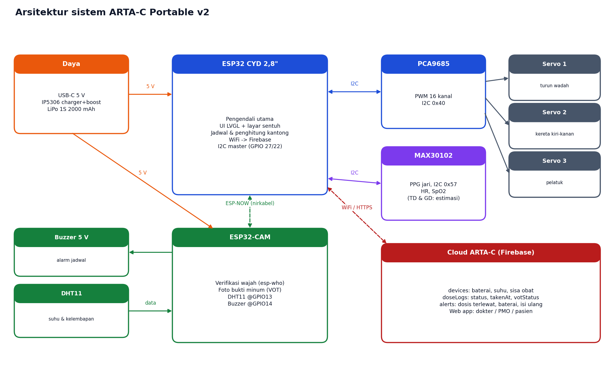

Sistem terdiri dari dua pengendali ESP32 yang saling berbicara secara nirkabel:

- **ESP32 CYD (pengendali utama)** memegang jadwal, antarmuka layar, penghitung kantong blister, ketiga servo (lewat PCA9685), sensor PPG MAX30102, dan koneksi ke cloud.
- **ESP32-CAM (pengendali kamera)** menangani verifikasi wajah, foto bukti minum obat, sensor DHT11, dan buzzer.
- Keduanya terhubung lewat **ESP-NOW**, jadi tidak ada kabel data di antara mereka. Pembagian ini dipilih karena CYD hanya punya dua GPIO bebas yang aman (GPIO 22 dan 27), sehingga keduanya dipakai sebagai bus I2C.

# 4. Desain mekanik

## 4.1 Tata letak

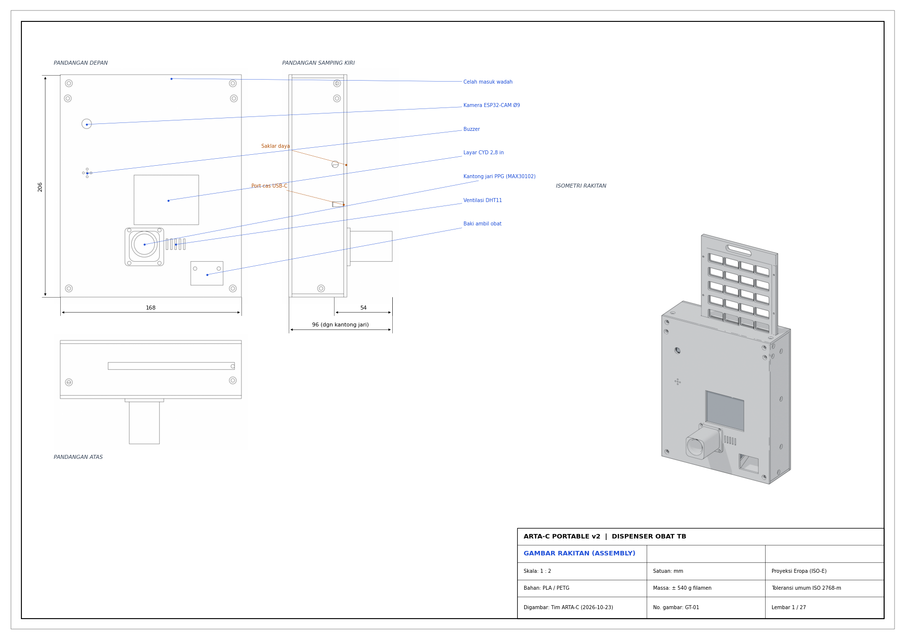

Alat berdiri tegak. Bagian dalamnya terbagi menjadi tiga lapisan dari depan ke belakang:

| Lapisan (arah tebal) | Isi |
|---|---|
| Depan (y 0–19 mm) | Layar CYD, ESP32-CAM, buzzer, DHT11, LiPo, IP5306, rel dan kereta pelatuk, tuas servo 2 |
| Tengah (y 24–30 mm) | Wadah blister yang naik-turun di dua pemandu, rack di sisi kiri, roda gigi G1/G2 |
| Belakang (y 30–48 mm) | Landasan penahan dorongan, celah jatuh kaplet, lantai miring, braket servo |

## 4.2 Subsistem dan part

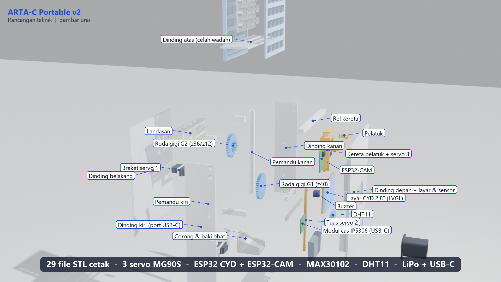

| Subsistem | Part | Fungsi |
|---|---|---|
| Enklosur | 6 dinding, 4 blok sudut | Kotak tertutup; dinding depan membawa dudukan layar, kantong elektronik, lubang kamera, buzzer, ventilasi DHT11, dan bukaan baki |
| Wadah | wadah belakang + wadah depan | Menjepit blister utuh. Pelat belakang berlubang 23 × 12,5 mm per kantong, bingkai depan berjendela 23,5 × 13 mm, rack modul 1 di sisi kiri |
| Penurun wadah | servo 1, G1 (z40), G2 (z36/z12), spacer, pemandu kiri & kanan | Menurunkan wadah satu baris (20,5 mm) per langkah |
| Kereta pelatuk | rel, kereta, servo 3, engkol, pelatuk, tuas + servo 2 | Menempatkan pelatuk di kolom 1–4 lalu mendorong kubah |
| Landasan & jalur keluar | landasan, corong & baki | Menahan dorongan pelatuk di belakang wadah; mengalirkan kaplet ke baki depan |
| Kantong jari PPG | kantong jari (PLA hitam) | Terowongan jari Ø19 mm kedap cahaya; MAX30102 di lantainya |

## 4.3 Perhitungan mekanisme

**Penurun wadah (servo 1).** Rangkaian roda gigi: G1 z40 di servo → G2 kecil z12, G2 besar z36 → rack.

- Rasio perpindahan rack: (40/12) × (36/2) = **60 mm/rad**, atau 1,05 mm per derajat servo.
- Langkah total 141 mm memerlukan 135° putaran servo, masih di dalam batas 180° MG90S.
- Gaya angkat rack: 0,176 N·m ÷ 0,060 m = **2,9 N**. Berat wadah ditambah blister sekitar 1,2 N, jadi cadangan gayanya lebih dari 2×.

| Baris di garis pelatuk | 1 | 2 | 3 | 4 | 5 | 6 | 7 |
|---|---|---|---|---|---|---|---|
| Sudut servo 1 | 17,2° | 36,8° | 56,3° | 75,9° | 95,5° | 115,1° | 134,6° |

(0° = posisi masuk/keluar wadah.)

**Penggeser kereta (servo 2).** Tuas sepanjang 113 mm berporos di servo 2 di bagian bawah alat. Pinnya masuk ke slot vertikal di kereta.

- Posisi kereta: x = 100 + 113·sin φ. Kolom 1–4 ada di x = 64, 88, 112, 136 mm, jadi sudut tuasnya −18,6°, −6,1°, +6,1°, +18,6° dari tengah.
- Resolusi sekitar 2 mm per derajat. Toleransinya cukup, karena bantalan pelatuk 14 mm masuk ke jendela 23,5 mm (margin ±4,7 mm).

**Pelatuk (servo 3).** Mekanisme scotch-yoke dengan engkol r = 6,3 mm, langkah 12,6 mm.

- Gaya dorong F(θ) = T / (r·sin θ). Nilai terkecilnya di θ = 90°: 0,176 / 0,0063 = **28 N**, dan makin besar menjelang akhir langkah, tepat saat foil robek.
- Gaya tembus foil blister aluminium umumnya ±15–30 N, jadi **wajib diuji dengan blister asli** (lihat Bab 9).
- Reaksi dorongan ditahan landasan, yang terdiri dari batang atas dan bawah dengan rusuk setiap 24 mm ke dinding belakang. Celah 13 mm di antara batang menjadi jalan keluar kaplet.

## 4.4 Kantong jari PPG

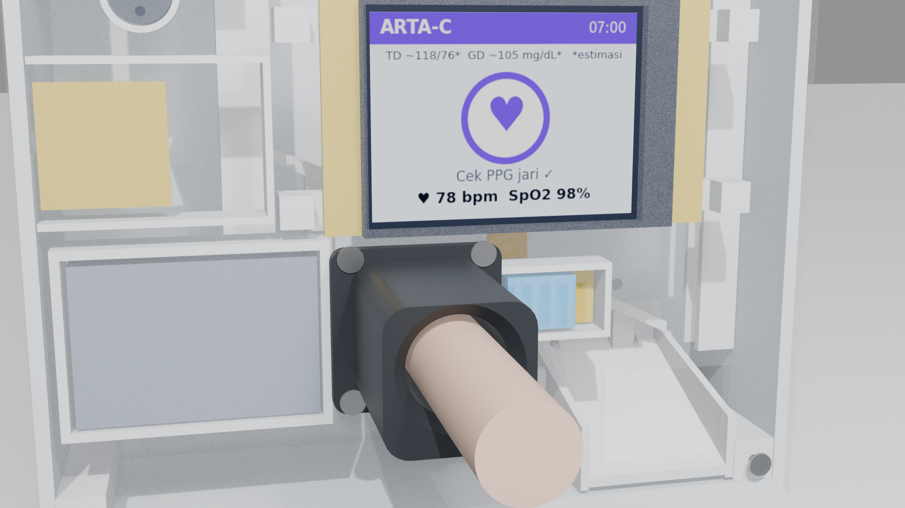

- Terowongan Ø19 × 35 mm dengan bibir masuk Ø24, menonjol 42 mm dari muka depan tepat di bawah layar.
- Sensor MAX30102 dipasang dari bawah dengan permukaan sensor menghadap ke atas. Jendela 6 × 8 mm berada 2–10 mm dari ujung lubang, tepat di bawah bantalan ujung jari.
- Dicetak dengan **PLA hitam** supaya cahaya luar tidak mengganggu sinyal PPG.
- Dipasang dengan 4 baut M3 + mur. Kabel sensor masuk ke dalam lewat lubang 8 × 4,5 mm.

## 4.5 Gambar teknik

Set lengkap 27 lembar A3 (proyeksi Eropa, toleransi umum ISO 2768-m) ada di `hardware/dispenser-portable/gambar_teknik/GT_ARTA-C_Portable_v2.pdf`:

- GT-01: rakitan
- GT-02: gambar urai dan daftar part
- GT-03 sampai GT-27: satu lembar per part

Seluruh geometri dihasilkan dari model parametrik `build.py`. Mengubah ukuran blister atau kaplet cukup dilakukan di bagian PARAMETER file itu.

# 5. Desain elektronik dan daya

## 5.1 Daftar komponen elektronik

| Komponen | Spesifikasi | Fungsi |
|---|---|---|
| ESP32-2432S028 (CYD) | ESP32-WROOM-32, LCD 2,8" ILI9341 + sentuh resistif | Pengendali utama, UI, WiFi |
| ESP32-CAM | ESP32 + OV2640 2 MP | Verifikasi wajah, foto bukti, DHT11, buzzer |
| PCA9685 | Driver PWM 16 kanal, I2C | Mengendalikan 3 servo |
| 3 × MG90S | Servo metal gear, 1,8 kg·cm @4,8 V | Penggerak wadah, kereta, pelatuk |
| MAX30102 | Sensor PPG (LED merah + IR), I2C | Detak jantung, SpO₂ |
| DHT11 | Suhu 0–50 °C ±2 °C, RH 20–90 % ±5 % | Kondisi ruang simpan obat |
| Buzzer aktif 5 V Ø12 mm | ±85 dB | Alarm jadwal |
| LiPo 1S 103450 | 3,7 V 2000 mAh | Baterai |
| IP5306 (USB-C) | Pengisi + boost 5 V 2,1 A | Cas ulang dan rel 5 V |
| Saklar toggle mini, kapasitor 1000 µF, transistor S8050, resistor 1 kΩ / 10 kΩ | | Saklar daya, peredam servo, penggerak buzzer, pull-up |

## 5.2 Pengkabelan

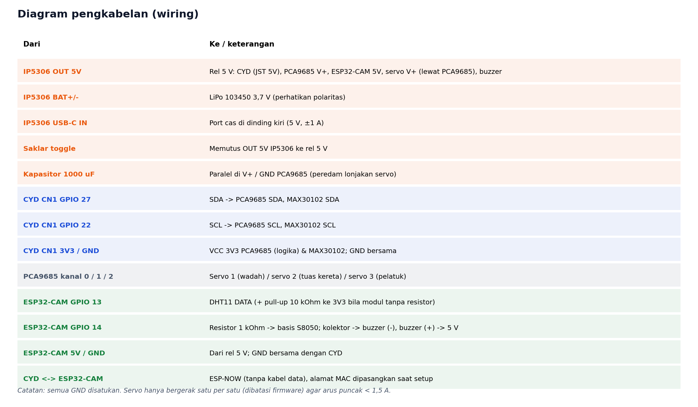

## 5.3 Anggaran daya

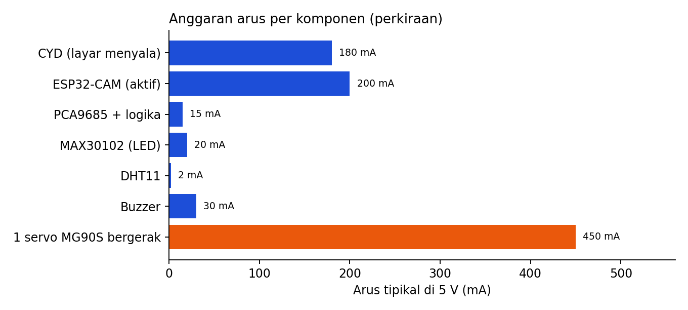

| Mode | Arus di 5 V (perkiraan) | Keterangan |
|---|---|---|
| Siaga (layar redup, ESP32-CAM light sleep) | ±90–120 mA | Sebagian besar waktu |
| Interaksi (layar terang, kamera aktif, WiFi kirim) | ±400–450 mA | ±2–3 menit per jadwal |
| Dispensing (1 servo bergerak) | puncak ±0,9–1,2 A | Beberapa detik per kaplet; servo bergerak bergantian |

Energi baterai: 3,7 V × 2 Ah = 7,4 Wh. Dengan efisiensi boost ±85 %, tersedia ±1,25 Ah pada 5 V. Pada siaga dengan layar redup (±100 mA), perkiraan daya tahan **±12 jam**. Pada mode hemat (layar mati saat siaga, ESP32-CAM deep sleep, rata-rata ±40–50 mA), daya tahan mencapai **±1–1,5 hari**. Untuk pemakaian rumah, alat disarankan tetap tersambung ke charger USB-C. Baterai berfungsi sebagai cadangan saat listrik padam atau saat alat dibawa bepergian.

## 5.4 Keselamatan listrik

- IP5306 sudah memiliki proteksi pengisian berlebih, pengosongan berlebih, dan hubung singkat. LiPo tetap disarankan memakai PCM (papan proteksi) bawaan.
- Kantong LiPo terpisah dari jalur servo dan tidak tertekan sekrup.
- Firmware membatasi agar hanya satu servo yang bergerak dalam satu waktu.

# 6. Firmware dan integrasi aplikasi

## 6.1 Pembagian tugas firmware

| Pengendali | Modul firmware |
|---|---|
| CYD (Arduino/ESP-IDF + LVGL) | UI LVGL (jadwal, status, kalibrasi); jadwal dan RTC (sinkron NTP); driver PCA9685 dan profil gerak servo (pelan, ±1°/15 ms); penghitung kantong blister di NVS; pembacaan MAX30102 (HR, SpO₂); klien Firebase (REST/SDK); master ESP-NOW |
| ESP32-CAM | Verifikasi wajah (esp-who: deteksi + pengenalan, ±5–10 wajah terdaftar); foto bukti JPEG; pembacaan DHT11 tiap 5 menit; buzzer; slave ESP-NOW |

## 6.2 Protokol ESP-NOW

Pesan berupa struct biner kecil (≤250 byte):

```
CYD -> CAM : {cmd: VERIFY | ENROLL | BUZZ_ON | BUZZ_OFF | PHOTO, scheduleId}
CAM -> CYD : {type: FACE_OK | FACE_FAIL | ENV | PHOTO_URL, score, tempC, humidity, ts}
```

## 6.3 Alur satu jadwal

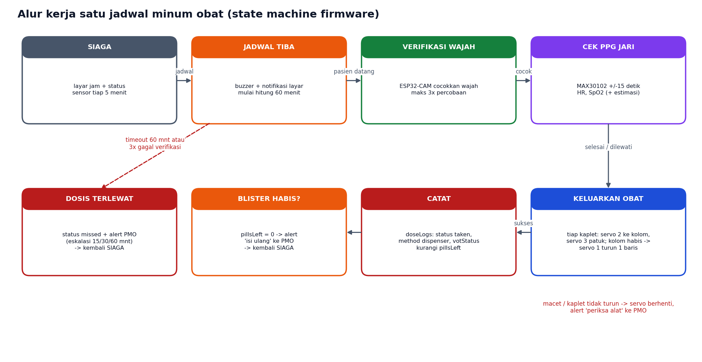

Aturan keamanan dosis di firmware:

- Satu jadwal hanya bisa dikeluarkan **sekali**. Setelah tercatat "taken", tombol dispensing dikunci sampai jadwal berikutnya.
- Posisi baris dan kolom kantong disimpan di NVS, sehingga tetap aman meski daya putus di tengah proses.
- Jumlah kaplet per dosis berasal dari jadwal dokter (`patients/{id}/schedules`), bukan dari input bebas pasien.

## 6.4 Integrasi ke aplikasi web ARTA-C

Firmware menulis ke koleksi Firestore yang sudah dipakai aplikasi web:

| Koleksi | Data dari alat |
|---|---|
| `devices/{deviceId}` | `battery`, `tempC`, `humidity`, `pillsLeft`, `pillsCapacity` (28), `dosePerDay`, `alarmOn`, `online`, `lastSeen`, `firmware` |
| `doseLogs` | `scheduledAt`, `takenAt`, `status` (taken / late / missed), `method: "dispenser"`, `votStatus: "verified"` bila wajah cocok |
| `alerts` | dosis terlewat, baterai lemah (<20 %), blister habis, gagal mekanis, suhu ruang di luar 15–30 °C |

Untuk data vital PPG, diusulkan koleksi baru `vitals` (`patientId`, `deviceId`, `hr`, `spo2`, `bpEst`, `glucoseEst`, `ts`). Aturan Firestore-nya perlu ditambahkan dengan pola yang sama seperti `doseLogs`.

Alat menulis atas nama tim perawatan pasien sesuai aturan `firestore.rules`, sehingga hanya dokter, PMO, dan pasien terkait yang bisa membaca datanya.

# 7. Cara penggunaan

## 7.1 Oleh PMO: mengisi obat

1. Buka wadah dengan melepas bingkai depan.
2. Letakkan blister utuh dengan **kubah menghadap ke depan** dan foil di belakang.
3. Pasang kembali bingkai depan.
4. Di layar, pilih **Isi ulang**. Alat menaikkan pengait wadah ke posisi masuk.
5. Masukkan wadah ke celah atas sampai tertahan roda gigi. Alat menarik wadah ke baris 1 secara otomatis.
6. Konfirmasi jumlah kaplet di layar. Aplikasi otomatis mencatat tanggal isi ulang.

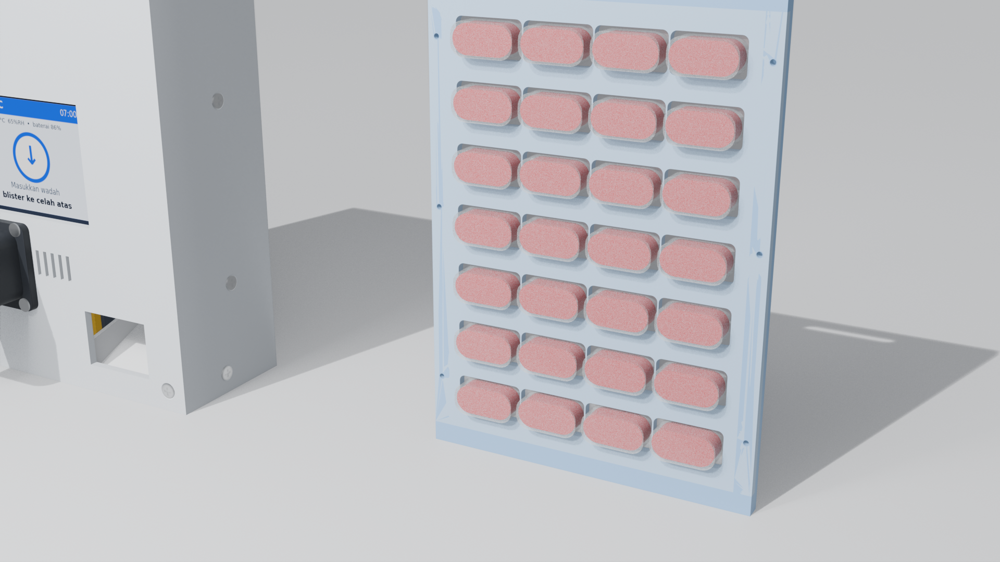

## 7.2 Oleh pasien: minum obat harian

1. Saat buzzer berbunyi, hadapkan wajah ke kamera di kiri atas.
2. Masukkan jari telunjuk ke kantong jari selama ±15 detik. Tetap diam supaya pembacaan akurat.
3. Ambil kaplet dari baki di kanan bawah, lalu minum di depan kamera bila diminta (foto bukti).
4. Layar hijau "Obat sudah keluar ✓" menandakan dosis tercatat.

## 7.3 Mengecas

Colokkan kabel USB-C ke port di **dinding kiri**. Indikator baterai tampil di layar. Saklar daya ada di atas port.

# 8. Manufaktur dan perakitan

- **Cetak 3D**: 29 file STL sudah dalam posisi cetak. Total ±555 g filamen dan ±60 jam di printer standar. Bed minimal 170 × 210 mm. Panduan rinci ada di `hardware/dispenser-portable/PANDUAN_CETAK.pdf`.
- **Bahan**: PLA untuk enklosur, rangka, dan wadah; PETG untuk roda gigi, pelatuk, engkol, tuas, dan kereta; PLA hitam untuk kantong jari.
- **Urutan rakit** (rinci di `README.md`):
  1. Pasang komponen di dinding belakang: blok sudut, pemandu, landasan, corong, dan braket servo.
  2. Pasang servo 1 + G1/G2 dan servo 2 + tuas.
  3. Pasang rel dan kereta beserta servo 3, engkol, dan pelatuk.
  4. Pasang elektronik di dinding depan: CYD, ESP32-CAM, buzzer, DHT11, LiPo, IP5306.
  5. Pasang kantong jari PPG.
  6. Tutup dengan dinding atas, bawah, kiri, kanan, lalu depan.
  7. Lakukan kalibrasi servo lewat menu LVGL.
- **Pengencang**: sekrup M3 × 8 kepala rata (±45), M3 × 25 + mur (poros G2), M3 × 10 + mur (kantong jari, 4 buah), M2 × 6 (±12).

# 9. Rencana pengujian dan validasi

| No | Uji | Metode | Kriteria lulus |
|---|---|---|---|
| U1 | Kecocokan cetak | Pasang semua part, cek gesekan wadah, kereta, roda gigi | Wadah turun-naik tanpa macet; kereta bergerak halus |
| U2 | Tembus foil | 28 kantong blister asli, ukur keberhasilan | ≥27/28 kaplet keluar utuh tanpa remuk |
| U3 | Akurasi posisi | Ulang 50× posisi kolom dan baris, ukur penyimpangan | Penyimpangan ≤ ±2 mm |
| U4 | Jalur keluar | 100 kaplet dijatuhkan dari semua kolom | ≥99 sampai di baki tanpa tersangkut |
| U5 | Dosis benar | Jadwal 3 kaplet × 10 hari simulasi | Jumlah keluar selalu tepat; tidak ada dobel dispensing |
| U6 | Verifikasi wajah | 5 pasien terdaftar + 10 wajah lain, berbagai cahaya | Terima benar ≥95 %; tolak orang lain ≥98 % |
| U7 | Akurasi PPG | Bandingkan dengan oksimeter jari medis, 20 orang | HR ±5 bpm; SpO₂ ±3 % |
| U8 | Estimasi TD & GD | Bandingkan dengan tensimeter dan glukometer | Dilaporkan sebagai data riset saja, tidak untuk keputusan klinis |
| U9 | Baterai | Siklus jadwal 3×/hari, mode hemat | ≥24 jam tanpa charger (layar redup: ≥10 jam) |
| U10 | Konektivitas | Putus WiFi 2 jam lalu sambung lagi | Log tersimpan lokal dan terkirim saat online |
| U11 | Daya tahan mekanis | 1.000 siklus pelatuk dan 200 siklus wadah | Tanpa retak; keausan gigi masih dalam batas |
| U12 | Keselamatan termal | Pengisian dan dispensing di 35 °C | Suhu LiPo < 45 °C |

# 10. Analisis risiko dan keselamatan

| Risiko | Akibat | Pencegahan / mitigasi |
|---|---|---|
| Kaplet tidak keluar (foil terlalu kuat) | Dosis kurang | Uji U2; deteksi gagal lewat waktu tempuh servo; alert PMO; opsi servo 3 MG946R |
| Dobel dispensing | Kelebihan dosis | Kunci per jadwal di firmware + NVS; jumlah dosis dari jadwal dokter |
| Wajah salah dikenali | Obat diminum orang lain | Ambang skor ketat, maks 3 percobaan, foto bukti untuk PMO |
| Data vital disalahartikan | Keputusan medis keliru | TD dan GD diberi label "estimasi"; HR/SpO₂ hanya sebagai pemantauan |
| Baterai habis | Alarm tidak berbunyi | Alert baterai <20 %; disarankan selalu tersambung charger di rumah |
| Kerusakan LiPo | Panas / bengkak | IP5306 + PCM; kantong LiPo tidak tertekan; uji termal U12 |
| Kelembapan merusak obat | Obat terurai | Obat tetap di blister; DHT11 memicu alert bila RH > 70 % |
| Anak membuka alat | Tertelan obat lain | Wadah terkunci roda gigi; obat hanya keluar per dosis |
| Privasi foto | Data pribadi bocor | Foto hanya disimpan di koleksi yang dibatasi aturan Firestore tim perawatan |

> ARTA-C Portable adalah **prototipe riset**. Alat ini belum tersertifikasi sebagai perangkat medis (izin edar Kemenkes / AKL). Fungsi pengukuran vital bersifat pemantauan dan tidak menggantikan pemeriksaan tenaga kesehatan.

# 11. Perawatan dan penanganan masalah

| Masalah | Penyebab | Penanganan |
|---|---|---|
| Wadah seret saat turun | Permukaan pemandu kasar | Ampelas 400, beri sedikit grafit |
| Roda gigi berbunyi / melompat | Elephant foot atau aus | Bersihkan gigi; cetak ulang G1/G2 dari PETG |
| Pelatuk meleset dari kubah | Kalibrasi kolom | Menu Kalibrasi → atur sudut servo 2 per kolom |
| Kaplet tersangkut di jalur | Lantai miring kotor | Lepas dinding belakang, bersihkan corong |
| PPG tidak terbaca | Jari bergerak / cahaya masuk | Masukkan jari penuh dan diam; pastikan kantong dari PLA hitam |
| Wajah tidak dikenali | Cahaya kurang | Pindahkan alat ke ruang terang, daftar ulang wajah |
| Tidak tersambung ke aplikasi | WiFi | Menu Jaringan → pilih WiFi ulang; data tetap tersimpan lokal |

Perawatan berkala:
- Bersihkan baki setiap minggu.
- Periksa sekrup setiap bulan.
- Ganti baterai bila daya tahannya turun di bawah 50 % (±300–500 siklus).

# 12. Batasan dan pengembangan lanjut

- Ukuran blister masih **perkiraan** dan harus diukur ulang. Semua dimensi parametrik di `build.py`.
- Gaya tembus foil, akurasi verifikasi wajah, dan akurasi PPG **belum diuji fisik** (lihat Bab 9).
- Estimasi tekanan darah dan gula darah dari PPG memerlukan riset algoritma dan kalibrasi per pasien.
- Pengembangan lanjut:
  - sensor optik di baki untuk memastikan kaplet benar-benar diambil
  - mode multi-blister untuk fase lanjutan terapi
  - kunci fisik wadah
  - PCB khusus menggantikan modul-modul
  - sertifikasi keamanan listrik dan uji klinis kecil bersama puskesmas

# 13. Lampiran

## 13.1 Daftar part cetak

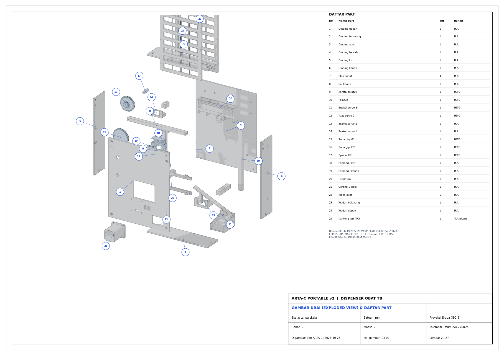

## 13.2 Estimasi biaya bahan (perkiraan harga pasar 2026, dapat berbeda)

| Item | Jml | Harga satuan (Rp) | Subtotal (Rp) |
|---|---|---|---|
| ESP32-2432S028 (CYD 2,8") | 1 | 180.000 | 180.000 |
| ESP32-CAM + OV2640 + papan programmer | 1 | 95.000 | 95.000 |
| Servo MG90S | 3 | 35.000 | 105.000 |
| PCA9685 | 1 | 45.000 | 45.000 |
| MAX30102 | 1 | 35.000 | 35.000 |
| DHT11 (modul) | 1 | 15.000 | 15.000 |
| Buzzer aktif 5 V | 1 | 3.000 | 3.000 |
| LiPo 103450 2000 mAh | 1 | 60.000 | 60.000 |
| Modul IP5306 USB-C | 1 | 25.000 | 25.000 |
| Saklar, kapasitor, transistor, resistor | 1 set | 10.000 | 10.000 |
| Kabel jumper / JST | 1 set | 20.000 | 20.000 |
| Sekrup dan mur M2/M3 | 1 set | 25.000 | 25.000 |
| Filamen PLA (±520 g dari rol 1 kg) | – | 200.000/kg | 104.000 |
| Filamen PETG (±35 g) | – | 230.000/kg | 8.000 |
| **Total perkiraan** | | | **±730.000** |

## 13.3 Daftar file

| Lokasi | Isi |
|---|---|
| `hardware/dispenser-portable/stl/` | 29 file STL siap cetak |
| `hardware/dispenser-portable/gambar_teknik/` | Gambar teknik A3 (PDF 27 lembar) |
| `hardware/dispenser-portable/animasi/` | Video cara kerja (1080p) dan video rancangan teknik (gambar urai) |
| `hardware/dispenser-portable/PANDUAN_CETAK.pdf` | Panduan cetak 3D |
| `hardware/dispenser-portable/README.md` | Perakitan, kabel, sudut servo |
| `hardware/dispenser-portable/ARTA-C_Portable_v2_STL.zip` | Bundel STL + panduan + gambar teknik |
| `hardware/dispenser-portable/build.py` | Model CAD parametrik dan cek tabrakan |
| `dokumen_teknis/` | Dokumen ini (MD + PDF) dan diagram |
| `public/`, `firestore.rules` | Aplikasi web ARTA-C dan aturan keamanan data |
