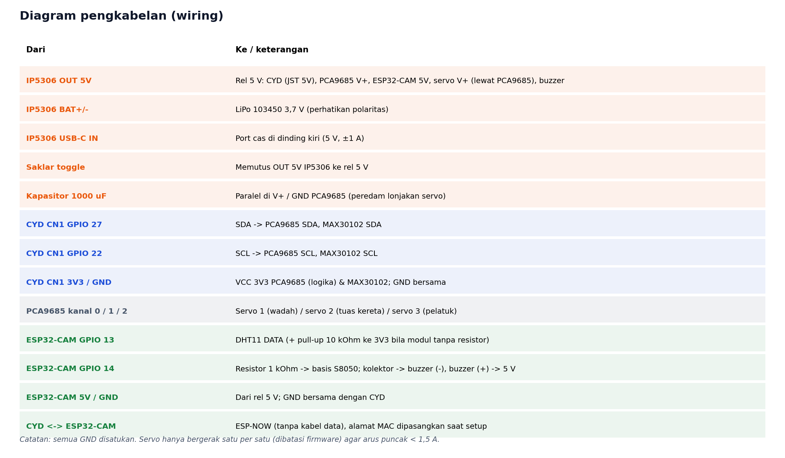
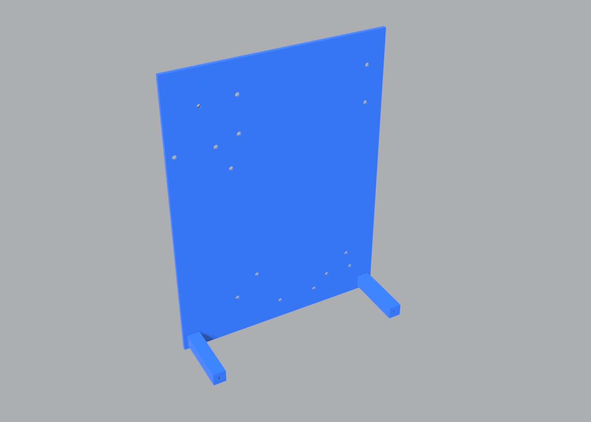
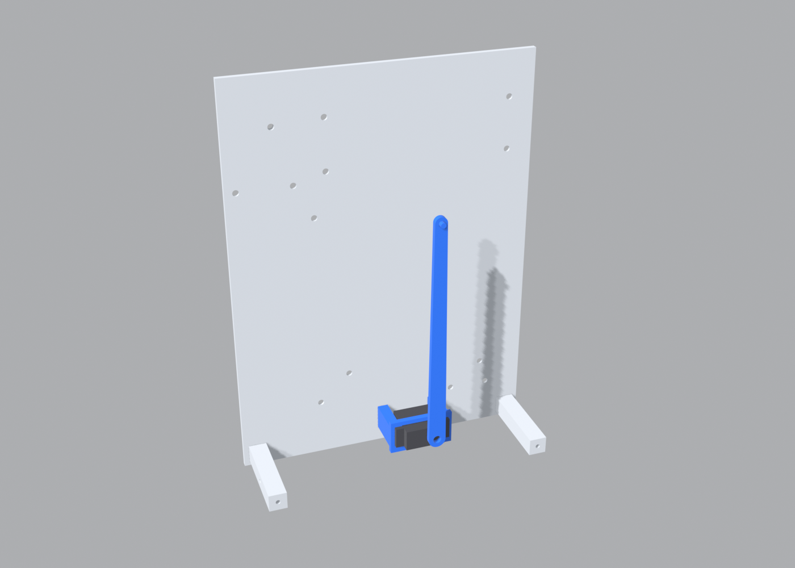
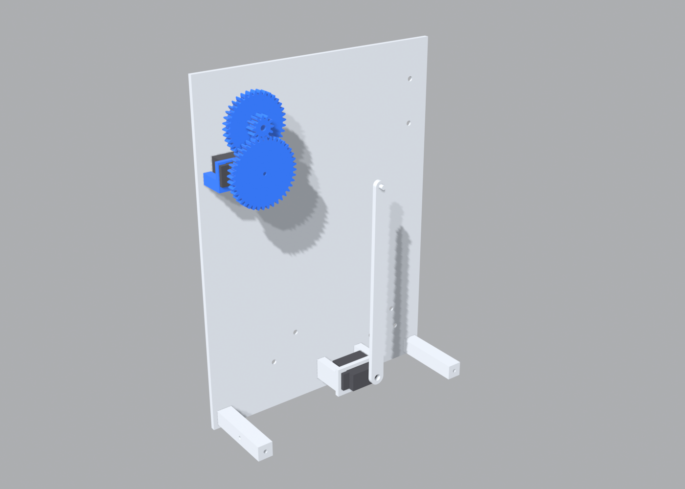
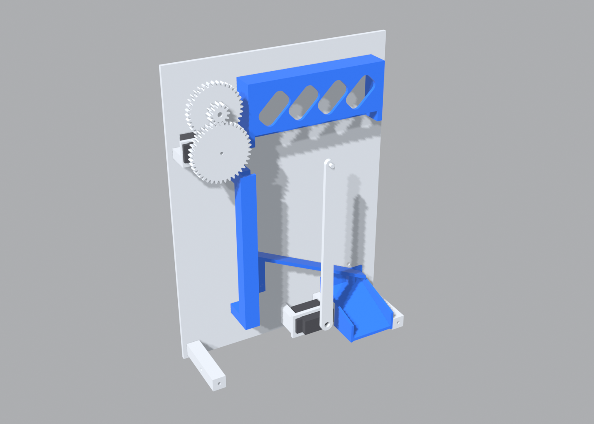
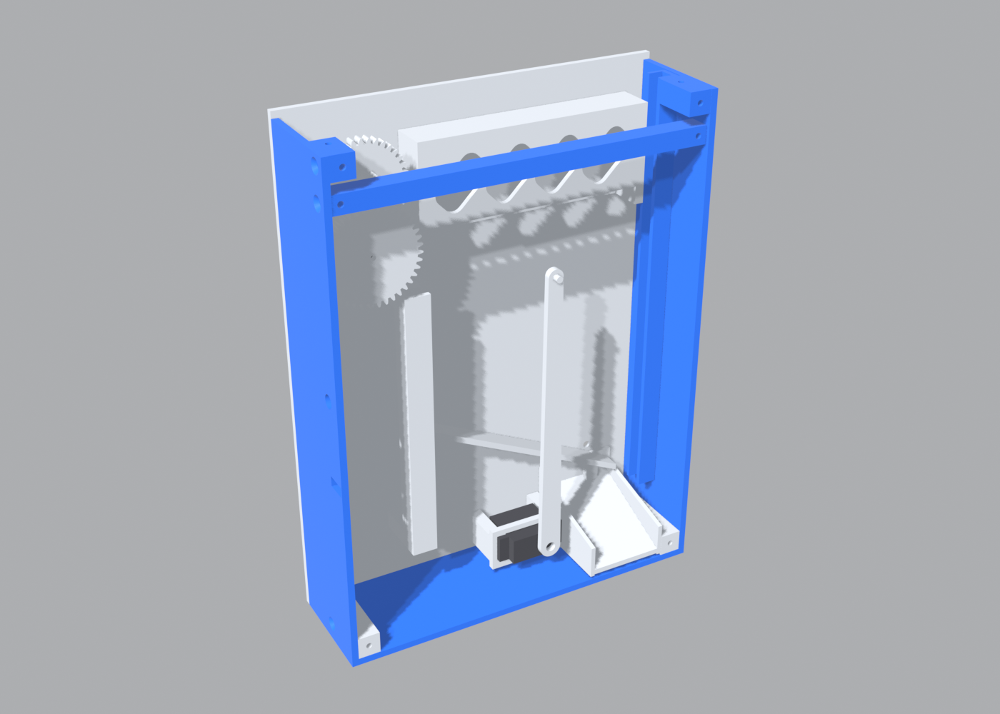
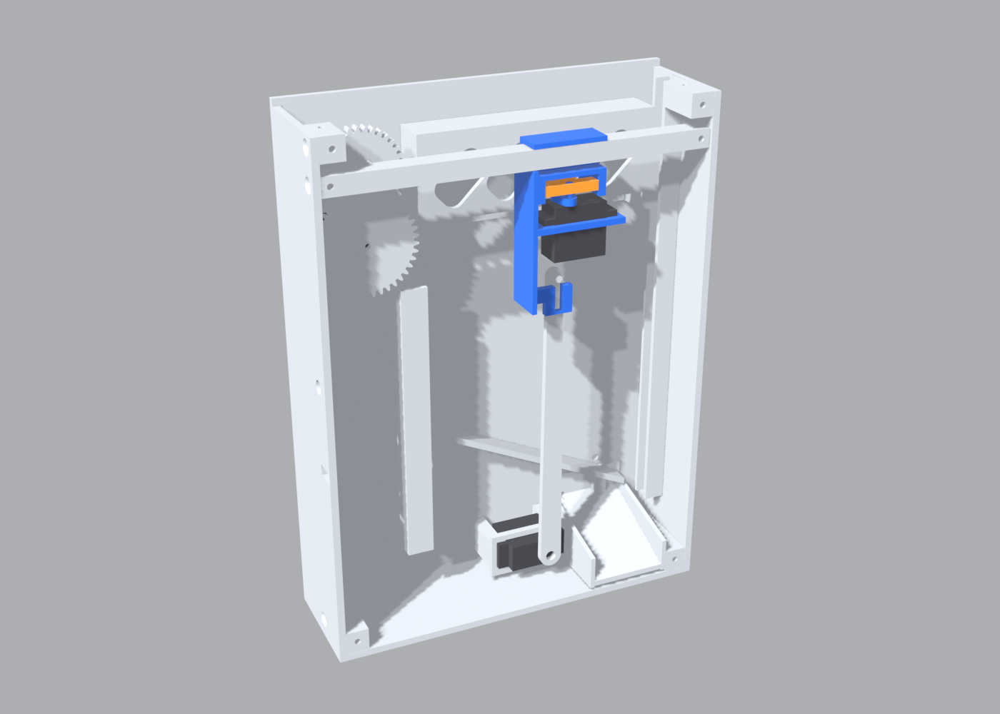
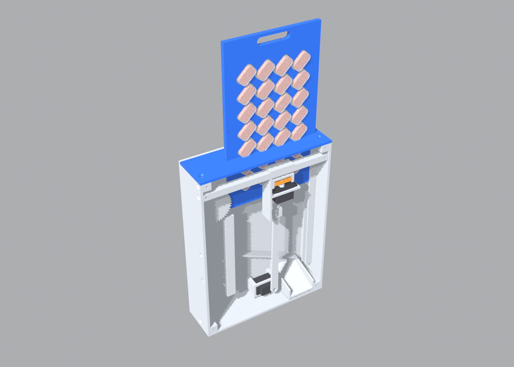
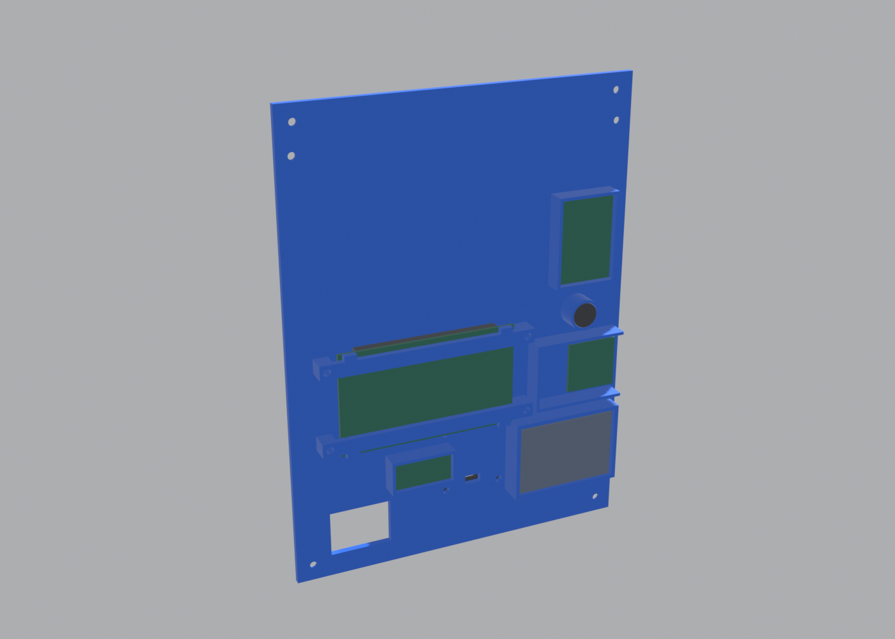
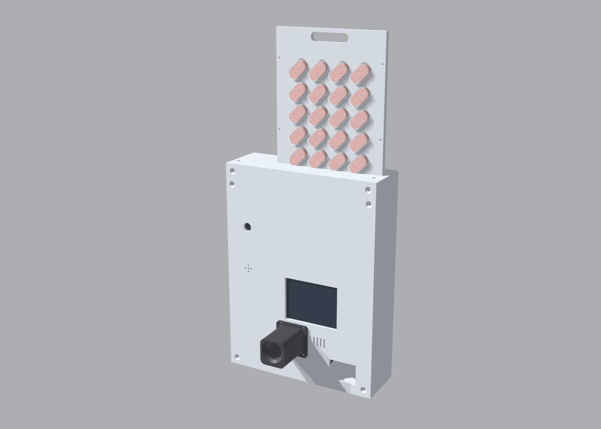

# Panduan Merakit ARTA-C Portable v2

Panduan ini menjelaskan cara merakit ARTA-C dari part hasil cetak 3D sampai alat siap dipakai. Panduan cetaknya
ada di `PANDUAN_CETAK.pdf`, dan ukuran lengkap tiap part ada di `GAMBAR_TEKNIK_ARTA-C_Portable_v2.pdf`.

Pada gambar langkah, **part berwarna biru adalah part yang dipasang pada langkah itu**. Part abu-abu sudah
terpasang sebelumnya, dan part hitam adalah servo atau modul elektronik.

> **Penting:** ARTA-C masih prototipe yang belum diuji fisik. Ukur ulang blister asli dan setiap modul yang dibeli
> sebelum merakit (lihat bagian 8). Hasil pengukuran PPG (nadi, SpO₂) hanya untuk pemantauan, bukan diagnosis.

## 1. Yang perlu disiapkan

### Part cetak (34 file STL, untuk Bambu Lab A1 mini)

Cocokkan dengan isi folder `stl/`. Dinding depan, belakang, kiri, kanan, dan wadah belakang dicetak dua belahan
(`_A_bawah` + `_B_atas`) dan **harus sudah dilem** sebelum merakit (PANDUAN_CETAK bagian 6). Bersihkan semua sisa support, terutama di **04_kereta** (alur yoke harus
licin) dan **15_landasan** (keempat celah miring harus bersih).

### Elektronik

| Komponen | Jumlah | Fungsi |
|---|---|---|
| ESP32-2432S028 (CYD 2,8") | 1 | Otak utama + layar sentuh LVGL |
| ESP32-CAM (OV2640) + adaptor USB-TTL (FTDI) | 1 | Verifikasi wajah, foto bukti minum; FTDI hanya untuk upload pertama |
| Servo MG90S (gigi logam) | 3 | Servo 1 = wadah, servo 2 = tuas kereta, servo 3 = pelatuk |
| PCA9685 (driver servo I2C) | 1 | Menggerakkan 3 servo dari CYD |
| MAX30102 | 1 | Sensor jari PPG (nadi, SpO₂) |
| DHT11 | 1 | Suhu dan kelembapan obat |
| Buzzer aktif 5 V Ø12 mm | 1 | Alarm jadwal minum |
| Transistor S8050 / 2N2222 + resistor 1 kΩ | 1 + 1 | Penggerak buzzer |
| Resistor 10 kΩ | 1 | Pull-up DHT11 (bila modulnya tanpa resistor) |
| IP5306 (charger + boost 5 V 2,1 A, port USB-C) | 1 | Cas baterai dan sumber 5 V |
| LiPo 1S 103450 (3,7 V, 2000 mAh) | 1 | Baterai |
| Saklar toggle mini Ø6 mm | 1 | Saklar daya |
| Kapasitor elektrolit 1000 µF / 10 V | 1 | Meredam lonjakan arus servo |
| Kabel jumper/dupont, kabel silikon 22–26 AWG, heat-shrink | secukupnya | |
| Lem CA (lem korea) atau epoksi 5 menit | 1 | Menyambung part yang dibelah |

### Baut dan pengencang

Semua lubang baut di rangka adalah **lubang pilot Ø2,6 mm**. Baut M3 dikencangkan langsung ke plastik (menyayat
ulir sendiri), jadi **jangan dikencangkan terlalu keras**.

| Baut | Jumlah (beli lebih) | Dipakai untuk |
|---|---|---|
| M3 × 10, kepala countersink (rata) | ±37 (beli 45) | Dinding ke blok sudut, part dalam ke dinding belakang, rel, pemandu kanan, klem layar |
| M3 × 12 + mur M3 | 4 | Kantong jari PPG ke dinding depan |
| M3 × 40 + mur nyloc M3 + 2 ring | 1 | Poros roda gigi G2 (dari luar dinding belakang) |
| M2 × 8 | 6 | Menyatukan wadah depan dan wadah belakang |
| Sekrup bawaan servo MG90S | 6 | Servo ke braket/kereta |

### Alat
Obeng plus PH0 dan PH1, solder + timah, multimeter, tang potong, cutter dan amplas 400, double tape busa, pengikat
kabel kecil, serta laptop dengan Arduino IDE / arduino-cli untuk memprogram.

## 2. Siapkan elektronik di meja dulu

Rakit dan uji semua elektronik **di luar kotak** sebelum dipasang. Kalau ada yang salah, jauh lebih mudah
diperbaiki di meja.

1. **Program CYD** dengan firmware `firmware/ARTA-C_CYD_UI` (lihat README firmware). Layar harus menampilkan UI ARTA-C.
2. **Program ESP32-CAM** lewat adaptor FTDI (GPIO 0 ke GND saat upload). Setelah alat tertutup, update berikutnya lewat OTA (WiFi).
3. **Sambungkan daya:** LiPo ke BAT+/BAT− IP5306 (**cek polaritas dua kali**), lalu saklar di jalur OUT 5 V.
   Nyalakan dan ukur OUT dengan multimeter. Nilainya harus 5,0–5,2 V sebelum disambung ke modul apa pun.
4. **Sambungkan semua modul** sesuai diagram kabel di bawah. GND semua modul harus tersambung jadi satu (GND bersama).
5. **Uji servo** lewat menu kalibrasi/servo test, lalu **setel posisi nol sebelum memasang lengan apa pun:**

| Servo | Kanal PCA9685 | Posisi nol saat merakit |
|---|---|---|
| Servo 1 (wadah, roda gigi G1) | 0 | **0°** = posisi masuk wadah |
| Servo 2 (tuas kereta) | 1 | **90°** = tuas tegak lurus |
| Servo 3 (pelatuk, engkol) | 2 | **0°** = pelatuk mundur penuh |

| Dari | Ke |
|---|---|
| IP5306 OUT 5 V (lewat saklar) | Rel 5 V: CYD (JST 5 V), PCA9685 V+, ESP32-CAM 5 V, buzzer (+) |
| IP5306 BAT+ / BAT− | LiPo 103450 |
| Kapasitor 1000 µF | Paralel di V+ / GND PCA9685 (kaki − ke GND) |
| CYD CN1 GPIO 27 (SDA) | PCA9685 SDA, MAX30102 SDA |
| CYD CN1 GPIO 22 (SCL) | PCA9685 SCL, MAX30102 SCL |
| CYD CN1 3V3 / GND | VCC PCA9685 (logika), VIN MAX30102, GND bersama |
| PCA9685 kanal 0 / 1 / 2 | Servo 1 / servo 2 / servo 3 |
| ESP32-CAM GPIO 13 | DHT11 DATA (+ pull-up 10 kΩ ke 3V3 bila perlu) |
| ESP32-CAM GPIO 14 | Resistor 1 kΩ → basis S8050; kolektor → buzzer (−); emitor → GND |
| CYD ↔ ESP32-CAM | Tanpa kabel data: ESP-NOW (alamat MAC dipasangkan saat setup) |

Tips: pakai konektor (dupont/JST) di kabel yang menyeberang dari dinding depan ke rangka belakang, dan sisakan
kabel **±15 cm**. Dengan begitu dinding depan bisa dibuka lagi tanpa memotong kabel.

## 3. Rangka belakang

### Langkah 1 — Dinding belakang + blok sudut bawah

1. Letakkan **01_dinding_belakang** di meja dengan sisi dalam (sisi berlubang pilot, bukan countersink) menghadap ke atas.
2. Pasang **02_blok_sudut_BL** dan **02_blok_sudut_BR** di dua sudut bawah. Kencangkan masing-masing dengan 1× M3 × 10 dari luar dinding belakang.

### Langkah 2 — Servo 2, braket, dan tuas

1. Masukkan servo 2 ke **08_braket_servo2** dengan poros menghadap ke depan. Kunci dengan 2 sekrup bawaan servo.
2. Pasang braket di tengah bawah dinding belakang dengan 2× M3 × 10 dari luar.
3. Pastikan servo 2 di **90°**, lalu tekan **07_tuas_servo2** ke spline servo **dalam posisi tegak lurus ke atas**. Pin di ujung tuas menghadap ke depan.

### Langkah 3 — Servo 1 dan roda gigi

1. Pasang servo 1 di **09_braket_servo1** (2 sekrup bawaan), lalu pasang braket di kiri atas dengan 2× M3 × 10.
2. Tekan **10_gear_G1_40T** ke spline servo 1 (servo di 0°).
3. Masukkan baut **M3 × 40** dari luar dinding belakang, pasang ring, **12_spacer_G2**, lalu **11_gear_G2_36T-12T**
   (gigi kecil 12T di sisi depan, sebidang dengan G1), ring, dan mur nyloc. G2 harus **berputar bebas tanpa goyang**. Kencangkan mur
   hanya sampai goyangnya hilang.
4. Putar G2 dengan tangan. Gigi G1 dan G2 harus berkait halus di seluruh putaran.

### Langkah 4 — Pemandu kiri, landasan, dan corong

1. **13_pemandu_kiri**: 2× M3 × 10 dari luar dinding belakang. Celahnya menjadi jalur rack wadah.
2. **15_landasan** (pelat dengan 4 celah miring 45°): 4× M3 × 10 dari luar. Celah miring harus searah dengan
   kantong blister (miring naik ke kanan, dilihat dari depan).
3. **16_corong_baki**: 4× M3 × 10 dari luar. Papan luncurnya menurun ke kanan, menuju bukaan baki di dinding depan.

## 4. Kotak dan kereta

### Langkah 5 — Dinding samping dan bawah, rel, pemandu kanan

1. Siapkan **02_blok_sudut_TL** dan **TR** untuk sudut atas. Blok ini nanti dikencangkan lewat dinding samping, dinding atas, dan dinding depan.
2. Pasang **01_dinding_bawah**, **01_dinding_kiri** (yang berlubang USB-C dan saklar), dan **01_dinding_kanan** ke
   blok sudut (M3 × 10 countersink).
3. Pasang **14_pemandu_kanan** ke dinding kanan (3× M3 × 10 dari luar).
4. Pasang **03_rel_kereta** melintang di atas dengan 1× M3 × 10 di tiap ujung, lewat dinding kiri dan kanan.

### Langkah 6 — Kereta pelatuk dan servo 3

1. Masukkan servo 3 ke **04_kereta** (2 sekrup bawaan).
2. Dengan servo 3 di **0°**, tekan **06_engkol_servo3** ke spline dengan pin engkol di sisi depan (pelatuk pada posisi mundur penuh).
3. Sisipkan **05_pelatuk** ke alur yoke, dengan pin engkol masuk ke slot pelatuk. Bantalan miringnya harus sejajar
   dengan kantong blister (45°). Putar servo 3 dari 0° ke 180°: pelatuk harus maju-mundur ±12,6 mm dengan lancar.
4. Kaitkan kereta ke rel dari depan, sambil memasukkan pin tuas servo 2 ke **garpu** di bawah kereta.
5. Uji gerak: ayunkan servo 2 dari −15° sampai +15° (relatif dari 90°). Kereta harus meluncur kiri-kanan tanpa macet.

### Langkah 7 — Wadah dan blister, lalu dinding atas

1. Letakkan blister asli (104 × 180 mm) di **19_wadah_belakang** dengan kubah menghadap ke depan.
2. Tutup dengan **20_wadah_depan**. Setiap kubah harus pas di jendelanya yang miring 45°. Kunci dengan 6× M2 × 8.
3. Pasang **01_dinding_atas**.
4. Dengan servo 1 di **0°**, masukkan wadah dari celah atas dengan rack di sisi kiri, sampai rack menyentuh G2. Gerakkan
   servo 1 pelan-pelan ke baris 1 (lihat tabel kalibrasi). Wadah harus turun rata tanpa tersendat.

## 5. Dinding depan dan elektronik

### Langkah 8 — Pasang modul di sisi dalam dinding depan

Gambar di atas adalah dinding depan **dilihat dari dalam**. Pasang:

1. **CYD**: layar masuk ke jendela layar, lalu jepit dengan **17_klem_layar_atas** dan **18_klem_layar_bawah** (2× M3 × 10 per klem).
2. **ESP32-CAM** di kiri atas, dengan lensa tepat di lubang Ø9 mm. Tempel dengan double tape busa dan lepas
   pita lensanya. Kalau lensa tidak pas di tengah lubang, foto akan terpotong.
3. **Buzzer** ke cincin di kiri (tepat di balik 5 lubang suara).
4. **DHT11** di balik kisi ventilasi (kanan bawah layar).
5. **LiPo** ke kantong kiri bawah, lalu **IP5306** di sebelahnya dengan port USB-C tepat di lubang dinding kiri.
6. **Kantong jari PPG** (21_kantong_jari_ppg, PLA hitam) dari luar dengan 4× M3 × 12 + mur. **MAX30102**
   masuk ke kantong papannya dengan sensor menghadap ke atas, ke lubang jendela. Kabelnya lewat lubang di dinding depan.
7. **PCA9685** dan kapasitor 1000 µF di balik layar. Tempel serata mungkin dengan double tape busa (header pin
   dibengkokkan). **Jaga jarak dari jalur tuas servo 2:** tuas berayun tepat di belakang layar (±14–17 mm dari muka
   depan) sejauh ±33 mm ke kiri-kanan. Sebelum menutup, ayunkan tuas dengan tangan dan pastikan tidak menyentuh
   PCA9685 atau kabel. Posisi PCA9685 ini **belum dicek di model CAD**.
8. Rapikan kabel dengan pengikat kabel kecil. Tidak boleh ada kabel di jalur wadah, kereta, tuas, maupun corong.

### Langkah 9 — Tutup kotak

1. Sambungkan semua konektor dari dinding depan ke rangka (servo ke PCA9685).
2. Pasang dinding depan ke empat blok sudut (4× M3 × 10 countersink). Sebelum dikencangkan penuh, pastikan
   tidak ada kabel yang terjepit.

## 6. Kalibrasi servo

Setel sudut ini di layar kalibrasi firmware (simpan di NVS). Angkanya dihitung dari model, jadi sesuaikan beberapa
derajat sampai pelatuk tepat di tengah kubah.

| Servo | Posisi | Sudut |
|---|---|---|
| Servo 1 (wadah) | Masuk/keluar wadah | 0° |
| | Baris 1 … 7 | 27,6° · 48,5° · 69,4° · 90,2° · 111,1° · 132,0° · 152,8° (±20,9° per baris) |
| Servo 2 (tuas) | Kolom 1 / 2 / 3 / 4 | −14,6° / −4,8° / +4,8° / +14,6° dari tengah (90°) |
| Servo 3 (pelatuk) | Mundur / tembus foil | 0° / 180°: gerakkan pelan (±1° per 15 ms), tahan 0,5 detik, kembali ke 0° |

Langkah kalibrasi:
1. Pasang blister **kosong** (sudah dipakai) dulu. Uji semua 28 posisi tanpa obat.
2. Untuk setiap baris, cek tanda tekanan pelatuk di kubah: harus di tengah. Geser sudut servo 1 (naik/turun)
   atau servo 2 (kiri/kanan) sedikit demi sedikit.
3. Uji dengan blister berisi obat: satu patukan harus mengeluarkan **tepat satu kaplet**. Kaplet harus jatuh ke baki
   depan bawah tanpa tersangkut.

## 7. Uji akhir (checklist)

- ☐ Port USB-C bisa mengecas (LED IP5306 menyala), dan saklar mematikan semua modul.
- ☐ Layar menyala, sentuhan bekerja, jam dan jadwal tampil.
- ☐ Alarm berbunyi pada jadwal.
- ☐ Wajah pasien yang terdaftar dikenali, dan wajah lain ditolak.
- ☐ Jari di kantong PPG menghasilkan nadi dan SpO₂ dalam ±15 detik.
- ☐ Wadah turun baris demi baris dengan rata, dan kereta mencapai keempat kolom.
- ☐ Satu patukan = satu kaplet di baki, dan dosis tercatat di aplikasi web ARTA-C (dipantau PMO).
- ☐ Suhu dan kelembapan dari DHT11 tampil masuk akal.

## 8. Ukur ulang sebelum merakit

Model dibuat dari ukuran perkiraan. Cocokkan dengan barang yang Anda beli, ubah nilainya di `build.py`, lalu
jalankan `python build.py` untuk membuat STL baru:

- **Blister:** 104 × 180 mm, kaplet 20,5 × 10,5 × 6,5 mm miring 45°, celah 7,5 mm (horizontal) / 7 mm (vertikal).
  Variabelnya `BL_W, BL_H, CAP_L, CAP_W, CAP_T, TILT, GAP_X, GAP_Z`.
- **Servo MG90S** (`SB_*`), posisi area aktif LCD CYD (`ACT_FROM_USB`), posisi lensa ESP32-CAM (`CAM`, `CAM_LENS`),
  dan posisi port USB-C IP5306 (`USBC`).

Cetak dan coba pasangkan **20_wadah_depan** ke blister asli lebih dulu (±46 g) sebelum mencetak semua part.

## 9. Masalah umum

| Masalah | Penyebab | Solusi |
|---|---|---|
| Wadah tersendat saat turun | Rack kasar / sisa support, G2 goyang | Amplas gigi rack, kencangkan mur nyloc G2 sampai tidak goyang |
| Pelatuk menekan di luar tengah kubah | Sudut servo belum dikalibrasi | Setel ulang sudut servo 1/2 di bagian 6 |
| Foil tidak tembus | Gaya servo 3 kurang, blister bergeser | Pastikan landasan terpasang rapat; jika tetap gagal, ganti servo 3 dengan MG946R |
| Kaplet tersangkut di landasan | Sisa support di celah miring | Bersihkan keempat celah, amplas tepinya |
| Alat mati saat servo bergerak | Lonjakan arus | Pasang kapasitor 1000 µF di PCA9685, cek baterai terisi |
| Kamera tidak mengenali wajah | Lensa tidak di tengah lubang, cahaya kurang | Atur posisi ESP32-CAM, pakai di ruangan terang |
| Tuas menyentuh kabel/PCA9685 | Komponen di jalur tuas | Pindahkan PCA9685 atau rapatkan ke punggung CYD |
