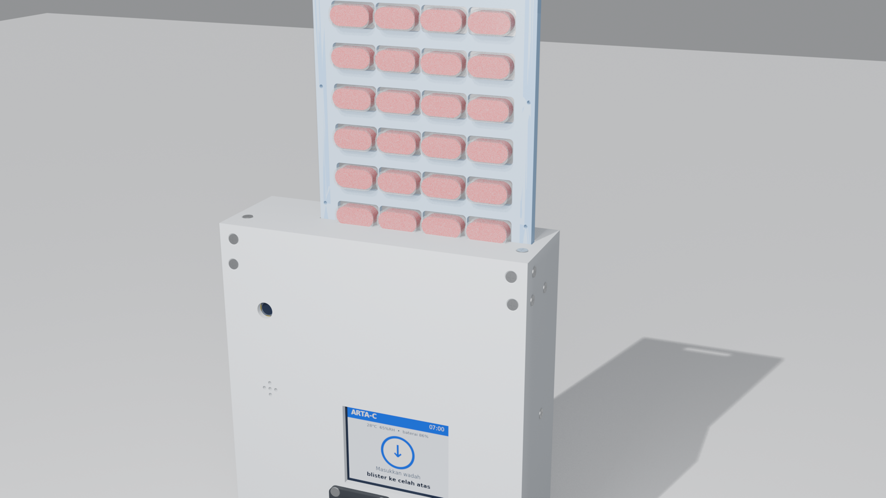
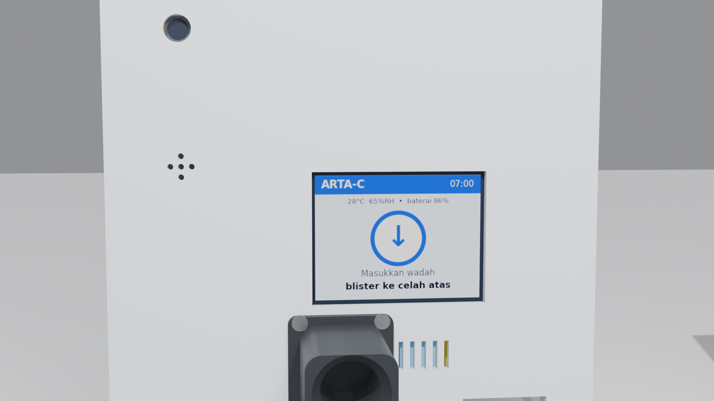
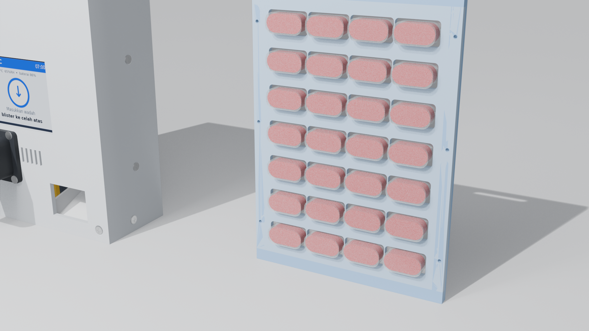
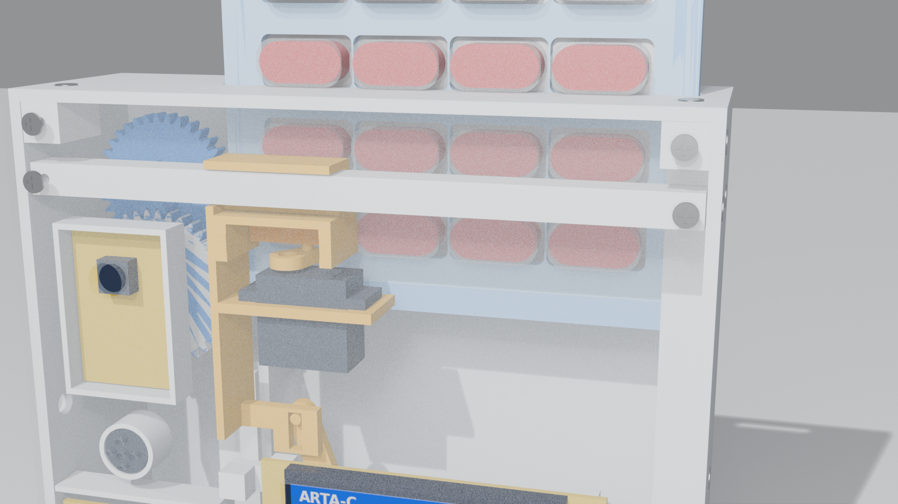
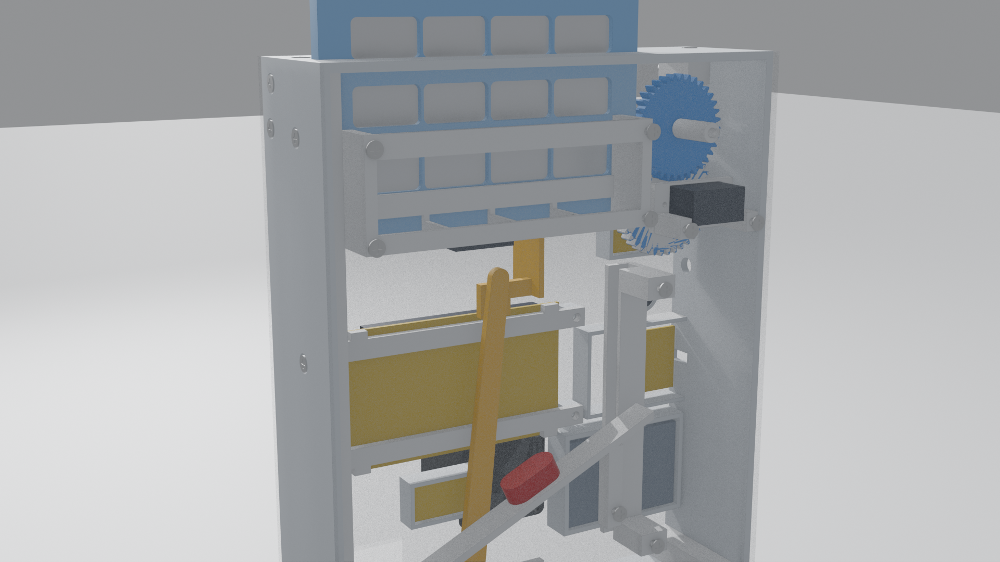
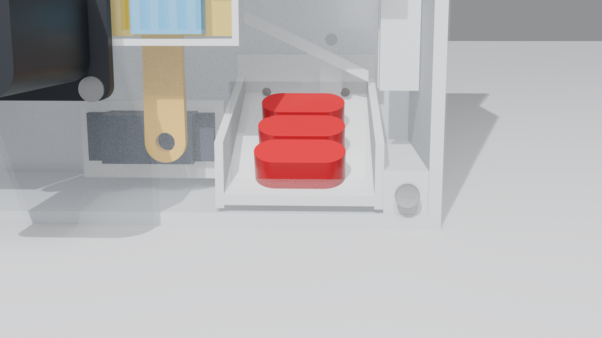

# ARTA-C Portable v2: dispenser obat TB konsep "pemanggang roti"

🎬 **Animasi cara kerja (1080p):** [`animasi/ARTA-C_portable_animasi.mp4`](animasi/ARTA-C_portable_animasi.mp4) (27 detik)
🛠️ **Video rancangan teknik (gambar urai berlabel):** [`animasi/ARTA-C_rancangan_teknik_exploded.mp4`](animasi/ARTA-C_rancangan_teknik_exploded.mp4)
📐 **Gambar teknik A3 (27 lembar):** [`gambar_teknik/GT_ARTA-C_Portable_v2.pdf`](gambar_teknik/GT_ARTA-C_Portable_v2.pdf)



Ukuran luar **168 × 206 × 54 mm** (lebar × tinggi × tebal). Perangkat berdiri tegak dan **seluruh bagiannya dicetak 3D**.

## Konsep

1. **Blister obat tetap utuh di bungkusnya.** PMO menjepit blister di dalam **wadah** (`19_wadah_belakang` + `20_wadah_depan`).
2. Wadah dimasukkan ke **celah di atas**. Mula-mula wadah menyembul seperti roti di pemanggang.
3. **Servo 1** memutar roda gigi G1 → G2 yang menggigit rack di sisi wadah. Wadah turun **perlahan, satu baris per langkah** (jarak baris 20,5 mm).
4. **Servo 2** mengayun tuas panjang di bawah, sehingga **kereta pelatuk bergerak kiri–kanan** ke kolom 1–4.
5. **Servo 3** di kereta memutar engkol (mekanisme scotch-yoke). Pelatuk **mematuk perlahan** menekan kubah sampai kaplet tembus foil ke belakang.
   Landasan di belakang wadah menahan tekanan itu dan menyisakan celah untuk kaplet keluar.
6. Kaplet jatuh ke lantai miring di belakang, meluncur ke kanan, lalu turun ke **baki ambil** di kanan-bawah depan.
7. **Layar CYD 2,8" (LVGL)** ada di muka depan.
8. **Fitur pemantauan pasien** di muka depan:
   - **ESP32-CAM** (kiri-atas, setinggi wajah) memverifikasi wajah pasien sebelum obat dikeluarkan, dan bisa memotret bukti minum obat untuk PMO.
   - **Kantong jari PPG** (`21_kantong_jari_ppg`): terowongan jari tertutup seperti oksimeter, menonjol 42 mm di bawah layar. Sensor **MAX30102** ada di lantai terowongan dekat ujung jari, dan terowongannya menghalangi cahaya luar. Hasil ukurnya:
     - **Detak jantung dan SpO₂**: terukur langsung oleh MAX30102.
     - **Tekanan darah dan gula darah**: hanya **estimasi eksperimental** dari bentuk gelombang PPG (perlu algoritma + kalibrasi per pasien). **Bukan alat diagnosis**; layar menandainya dengan tanda bintang (*).
   - **DHT11** di balik kisi ventilasi membaca suhu dan kelembapan ruang (kondisi simpan obat).
   - **Buzzer** dengan lubang suara di kiri, sebagai alarm jadwal minum obat.
9. **Isi ulang daya:** baterai LiPo 2000 mAh ada di kantong kiri-bawah. Modul IP5306 menempel di dinding kiri, sehingga **port USB-C untuk mengecas** keluar lewat dinding kiri. Di atasnya ada saklar daya.



Pelatuk bisa menjangkau ke-28 kantong. Jumlah kaplet per hari (2–5) diatur di firmware: kereta mematuk kolom demi kolom, dan setelah satu baris habis, wadah diturunkan satu baris.

| Blister masuk wadah | Pelatuk mematuk | Kaplet keluar ke belakang | Obat di baki |
|---|---|---|---|
|  |  |  |  |

## Part cetak (`stl/`, sudah dalam posisi cetak; panduan lengkap di [PANDUAN_CETAK.md](PANDUAN_CETAK.md))

| # | Part | Catatan |
|---|---|---|
| 01 | dinding depan/belakang/atas/bawah/kiri/kanan | Tebal 3 mm, lubang sekrup ber-countersink. Dinding depan sudah termasuk dudukan layar, kantong LiPo, kantong IP5306, kantong ESP32-CAM, cincin buzzer, lubang kabel & baut kantong jari PPG, dan ventilasi DHT11. Dinding kiri punya lubang port USB-C dan saklar. Butuh bed minimal **170 × 210 mm**. |
| 02 | blok_sudut BL/BR/TL/TR | Pengikat dinding (sekrup M3) |
| 03 | rel_kereta | Rel kereta pelatuk |
| 04–06 | kereta, pelatuk, engkol_servo3 | Kereta + bantalan pelatuk 14×7 mm |
| 07 | tuas_servo2 | Tuas 113 mm, pin masuk slot di bawah kereta |
| 08–09 | braket_servo2, braket_servo1 | |
| 10–12 | gear G1 40T, gear G2 36T/12T, spacer G2 | Modul 1. **PETG** lebih awet. G2 berputar pada baut M3 dari dinding belakang. |
| 13–14 | pemandu_kiri, pemandu_kanan | Jalur naik-turun wadah |
| 15 | landasan | Penahan dorongan pelatuk di belakang wadah |
| 16 | corong_baki | Lantai miring, papan luncur, dan baki ambil |
| 17–18 | klem_layar atas/bawah | Menjepit CYD ke jendela |
| 19–20 | wadah_belakang, wadah_depan | **Wadah obat PMO.** Cetak 2 set supaya bisa bergantian. |
| 21 | kantong_jari_ppg | Terowongan jari Ø19 × 35 mm + kantong papan MAX30102. Cetak **PLA hitam** supaya kedap cahaya. Dibaut 4× M3 + mur ke dinding depan. |

Total sekitar **555 g filamen** (1 rol 1 kg cukup). **Cara mencetak: lihat [PANDUAN_CETAK.md](PANDUAN_CETAK.md).** `python build.py` mencetak berat per part dan mengecek tabrakan di semua posisi gerak (hasil terakhir: aman).

## Elektronik

| Komponen | Letak | Sambungan |
|---|---|---|
| **ESP32-2432S028 (CYD 2,8")**: otak utama + layar LVGL | muka depan tengah | I2C: SDA = GPIO 27, SCL = GPIO 22 (konektor CN1) |
| **PCA9685** (driver 16 servo, I2C 0x40) | di balik layar | I2C CYD → 3× MG90S |
| **3× MG90S** (wadah, tuas kereta, pelatuk) | mekanisme | PCA9685 kanal 0, 1, 2 |
| **MAX30102** (sensor PPG: detak jantung, SpO₂; estimasi TD & gula darah) | lantai kantong jari PPG di bawah layar | I2C CYD (bersama PCA9685); kabel lewat lubang di dinding depan |
| **ESP32-CAM** (OV2640) | kiri-atas, lensa di lubang Ø9 | Komunikasi ke CYD **tanpa kabel lewat ESP-NOW**; hanya perlu 5 V + GND |
| **DHT11** (suhu & kelembapan) | balik kisi ventilasi | Data ke **GPIO 13 ESP32-CAM** (+ resistor pull-up 10 kΩ bila modulnya tanpa resistor) |
| **Buzzer aktif 5 V** (Ø12 mm) | kiri, lubang suara | **GPIO 14 ESP32-CAM** lewat transistor NPN (2N2222/S8050) + resistor 1 kΩ |
| **LiPo 1S 103450** (3,7 V, 2000 mAh) | kantong kiri-bawah | ke IP5306 |
| **IP5306** (charger + boost 5 V 2,1 A, USB-C) | pojok kiri, menempel dinding kiri | **Port USB-C keluar lewat dinding kiri** untuk mengecas; output 5 V ke semua modul |
| Saklar toggle mini Ø6 | dinding kiri | memutus output 5 V |
| Kapasitor 1000 µF / 10 V | dekat PCA9685 | meredam lonjakan arus servo |

Alasan pembagian ini: CYD hanya punya 2 GPIO bebas yang aman (22 dan 27), jadi keduanya dipakai sebagai bus I2C untuk servo dan MAX30102. DHT11 dan buzzer dipindah ke pin bebas ESP32-CAM (GPIO 13 dan 14, slot microSD tidak dipakai). Kedua ESP32 saling bicara lewat ESP-NOW, jadi tidak perlu kabel data.

**Alur verifikasi:** saat jadwal tiba, buzzer berbunyi dan layar meminta pasien menghadap kamera. ESP32-CAM mencocokkan wajah dengan wajah yang sudah didaftarkan (pustaka esp-who, cocok untuk beberapa wajah). Kalau cocok, ESP32-CAM mengirim "OK" ke CYD lewat ESP-NOW. Pasien lalu memasukkan jari ke kantong jari PPG (±15 detik pengukuran), obat dikeluarkan, dan foto bukti bisa dikirim ke aplikasi web ARTA-C (Firebase) untuk dipantau PMO.

**Daya:** semua modul mengambil 5 V dari IP5306. Servo bergerak bergantian, jadi puncak arusnya sekitar 1,2–1,5 A, masih di bawah batas 2,1 A. Baterai 2000 mAh cukup untuk ±1–2 hari pemakaian normal (layar redup saat idle, kamera hanya menyala saat verifikasi). Cas lewat USB-C 5 V.

**Pemrograman:** CYD dan ESP32-CAM ada di dalam kotak, jadi setelah pemasangan pertama, update firmware lewat **OTA (WiFi)**. ESP32-CAM perlu adaptor USB-TTL (FTDI) untuk upload pertama kali, sebelum dipasang.

## Gerakan (untuk firmware)

| Servo | Posisi |
|---|---|
| Servo 1 (wadah) | 0° = masuk/keluar wadah; baris 1 ≈ 17°, lalu **+19,6° per baris**; baris 7 ≈ 135° |
| Servo 2 (tuas) | tengah = 90°; kolom 1 = −18,6°, kolom 2 = −6,1°, kolom 3 = +6,1°, kolom 4 = +18,6° (relatif dari tengah) |
| Servo 3 (pelatuk) | 0° = naik, 180° = tembus. Gerakkan pelan (±1°/15 ms), tahan 0,5 detik, lalu kembali ke 0°. |

Urutan satu dosis:

```
untuk tiap kaplet:
  kalau kolom > 4: servo3 = 0, servo1 turun 1 baris, kolom = 1
  servo2 ke kolom
  servo3 patuk pelan
  kolom += 1
```

Simpan posisi baris dan kolom di NVS supaya tidak hilang saat mati daya. Sediakan layar kalibrasi LVGL untuk menyetel sudut tiap servo.

## WAJIB diukur ulang

Parameter ada di bagian atas `build.py`:

- Blister: `BL_W, BL_H` (dipakai 100 × 150), jarak kantong `PX, PZ` (24 × 20,5), ukuran kantong `POC_X, POC_Z`, tinggi kubah `DOME_H` (8)
- Kaplet: `CAP_L, CAP_W, CAP_T`
- Ukuran MG90S (`SB_*`) dan posisi area aktif LCD (`ACT_FROM_USB`)
- Posisi port USB-C modul IP5306 di dinding kiri (`USBC`), posisi lensa ESP32-CAM (`CAM`, `CAM_LENS`): cocokkan dengan modul yang dibeli

Setelah parameter diubah, jalankan `python build.py` (STL + cek tabrakan), lalu `python anim.py` untuk animasi dan render.
Animasi dan render butuh Blender 5.x dan ffmpeg.

## Catatan

- Gaya tekan untuk merobek foil blister bisa sekitar 20–30 N. MG90S dengan engkol 6,3 mm cukup karena gayanya makin besar menjelang akhir langkah, tapi tetap uji dengan blister asli.
- Kalau masih gagal, ganti servo 3 dengan MG946R pada braket yang lebih besar, atau perkecil engkol.
- Model v1 (kaset 7 hari) disimpan di `arsip_v1_kaset/`.
