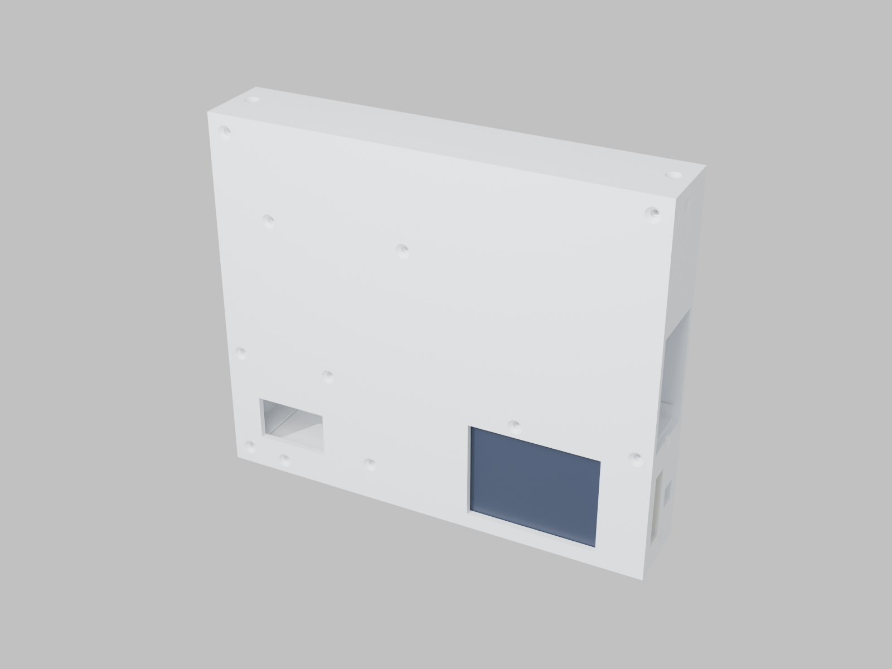
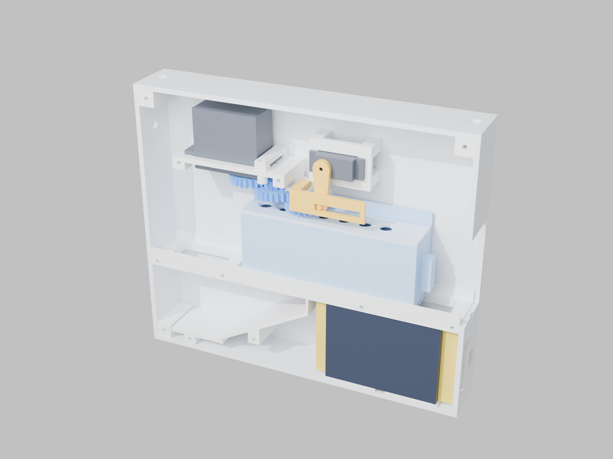
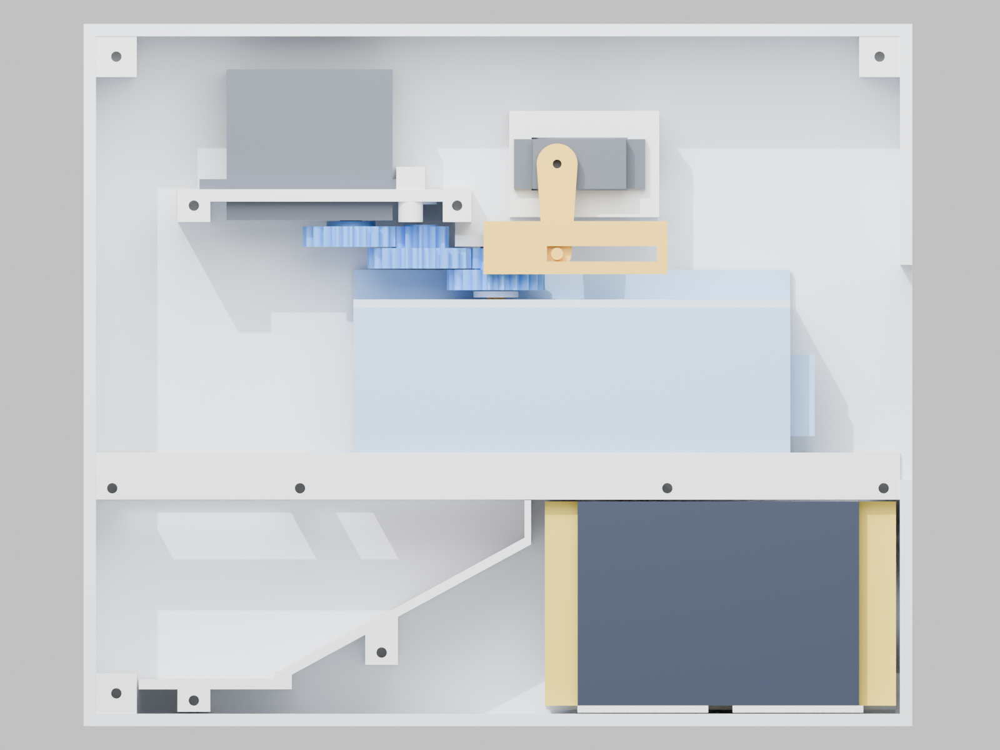
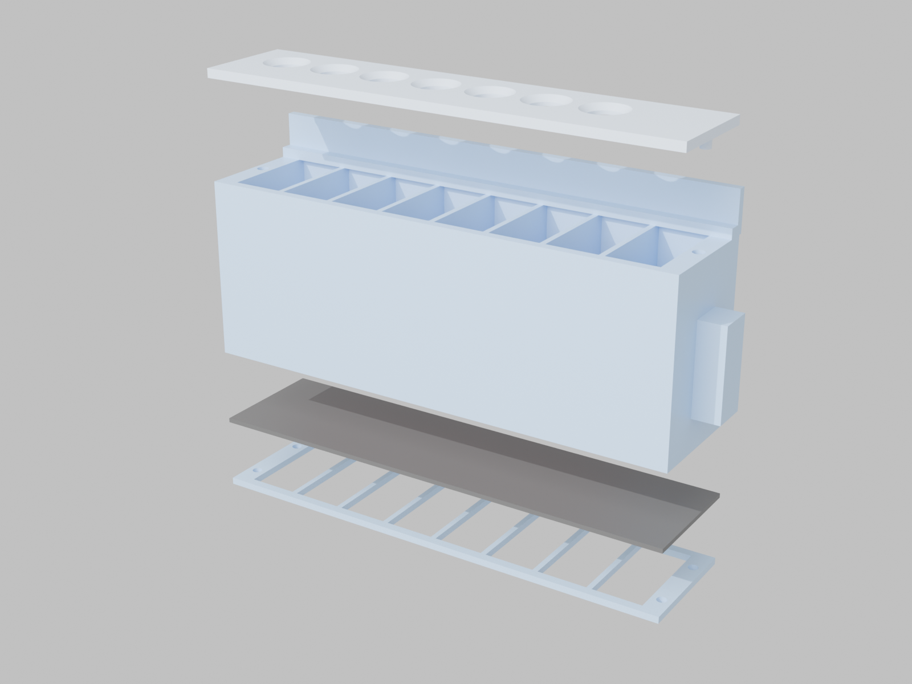

# ARTA-C Portable: dispenser obat TB (seluruhnya cetak 3D)

Ukuran luar **203 × 172 × 36 mm** (lebar × tinggi × tebal). Perangkat dipakai berdiri tegak di meja.
Semua bagian dicetak 3D: rangka sekitar 65 g dan dinding 3 mm sekitar 210 g, jadi **total ±275 g filamen**.
Dinding depan dan belakang berukuran 203 × 172 mm, sehingga butuh bed minimal **210 × 180 mm**.

🎬 **Animasi:** [`animasi/ARTA-C_portable_animasi.mp4`](animasi/ARTA-C_portable_animasi.mp4)
(blister → isi kaset → kaset masuk → gear menggeser → pelatuk turun → obat keluar di baki)

## Konsep kerja

1. **Wadah obat PMO = kaset 7 hari** (`14_kaset_badan`). Kaset punya 7 sel untuk hari 1–7, ditambah 1 sel parkir yang kosong.
   Setiap sel memuat dosis satu hari (2–5 kaplet 4FDC yang ditumpuk mendatar).
   PMO mengisi kaset, menutupnya, lalu memasukkannya lewat lubang di dinding kanan.
2. Lantai setiap sel berupa **membran karet berbelah "I"**. Kaplet tidak jatuh walau kaset dibalik atau dicabut.
3. **Servo A (MG946R)** menggeser kaset **kiri–kanan** lewat rack di punggung kaset dan 3 roda gigi (rasio 37,2 mm/rad).
   Dengan begitu sel hari ini berhenti tepat di bawah pelatuk.
4. **Servo B (MG90S)** memutar engkol 22 mm (mekanisme scotch-yoke). Akibatnya **pelatuk** turun perlahan sejauh 44 mm, masuk ke sel lewat lubang tutup,
   lalu mendorong kaplet menembus membran. Kaplet jatuh ke corong, meluncur, dan berhenti di **baki ambil** di kiri-bawah depan.
5. Layar **ESP32-2432S028 (CYD 2,8", LVGL)** ada di kanan-bawah depan. **Baterai LiPo + modul daya** berada di belakang layar.

> **Kenapa kaset, bukan blister utuh?** Blister 4×7 butuh 3 gerakan: kolom, baris, lalu dorong.
> Batasnya hanya 2 servo, jadi blister dipindah ke kaset harian berisi 1 baris × 7 hari.
> Wadah ini yang bergerak kiri–kanan, dan pelatuk "masuk" ke dalamnya.
>
> **Kenapa servo B pakai MG90S?** MG946R yang porosnya menghadap depan butuh tebal kotak sekitar 50 mm.
> MG90S cukup dengan 36 mm. MG946R tetap dipakai untuk servo A (rebah di atas dek).

## Isi folder

| Folder/berkas | Isi |
|---|---|
| `stl/` | 26 part siap slice (19 rangka/mekanisme + 7 dinding). Orientasi cetak sudah diatur, part sudah rebah di bed. |
| `dxf/` | `membran_karet_kaset.dxf`: templat potong karet 1:1 |
| `animasi/` | Video animasi 3D (MP4, 24 detik) |
| `rakitan.glb` | Rakitan berwarna. Bisa dibuka dengan Windows 3D Viewer atau Blender. |
| `build.py` | Model parametrik. Ubah parameter → `python build.py` → semua STL, DXF, dan lubang ikut berubah. Skrip ini juga mengecek tabrakan antar-part. |
| `render.py`, `render_blender.py`, `anim.py` | Membuat ulang `rakitan.glb`, gambar `render/`, dan video `animasi/` (butuh Blender 5.x dan ffmpeg) |

## Daftar part cetak (PLA/PETG, layer 0,2, infill 20%, dinding 3)

| # | Part | Jml | Catatan |
|---|---|---|---|
| 01 | rel_kaset | 1 | Rel kaset dan 4 balok lintang |
| 02 | corong_baki | 1 | Dicetak berdiri (profil di bed) |
| 03 | blok_sudut BL/TL/TR/BR | 4 | BR setengah tebal (di belakang layar) |
| 04 | dek_servoA | 1 | Pakai **support** di bawah lengan tabung |
| 05 | klem_servoA | 1 | Menjepit kuping kanan MG946R |
| 06 | tabung_poros_G3 | 1 | Lubang persegi 5 mm (batang tidak berputar) |
| 07–09 | gear G1 (22T), G2 (24/12T), G3 (22/13T) | 1 set | Modul 1. Cetak lambat; **PETG** lebih awet. |
| 10 | pelatuk | 1 | Dicetak terbalik; batang 4,4 mm, kecepatan rendah |
| 11 | engkol_servoB | 1 | Pin Ø3 di ujung |
| 12 | braket_servoB | 1 | |
| 13 | dudukan_layar_baterai | 1 | Pakai **support** di 4 bantalan depan |
| 14 | kaset_badan | 1 | Termasuk rack dan pegangan. Cetak tegak. |
| 15 | kaset_alas | 1 | Penjepit membran |
| 16 | kaset_tutup | 1 | 7 lubang berbentuk corong |
| 17–23 | dinding depan/belakang/atas/bawah/kiri/kanan (2 potong) | 7 | Tebal 3 mm. Cetak **muka luar menghadap bed** supaya rata; lubang sekrup sudah ber-countersink. Dinding 3, top/bottom 4 layer. |

Sebaiknya cetak 2 set kaset (14–16) supaya PMO bisa menyiapkan minggu berikutnya.
Bed lebih kecil dari 210 × 180? Kabari, dinding depan/belakang bisa saya belah dua dengan sambungan.

## Bahan lain (BOM)

- Servo **TowerPro MG946R** ×1 (servo A) dan **MG90S** ×1 (servo B)
- ESP32-2432S028 (CYD 2,8")
- LiPo 1S **103450** (10×34×50 mm, ±2000 mAh)
- Modul **IP5306** (charge + boost 5 V 2,1 A) atau modul sejenis
- Saklar toggle mini Ø6
- Kapasitor elektrolit 1000 µF/10 V (di jalur 5 V servo)
- Karet/silikon lembaran **0,8–1 mm** untuk membran (atau cetak TPU 95A 1 mm)
- Sekrup M3×8 ±50, M3×25 + mur 1 (poros G2), M2×6 ±10 (alas kaset, flens MG90S)

## Perakitan singkat

1. **Dinding belakang** jadi alas kerja. Pasang blok sudut, rel, corong, dek, braket B, dan dudukan layar dengan sekrup dari luar dinding.
2. Pasang MG946R terbalik pada dek: poros menghadap ke bawah, kuping kiri disekrup, kuping kanan dijepit `klem_servoA`.
3. Masukkan tabung G3 dari bawah lewat G3, lalu tekan ke lengan dek. Rekatkan sedikit bila perlu.
   G2 berputar pada baut M3×25 dari atas dek, dikunci mur di bawah. Tekan G1 ke spline servo dan kunci dengan sekrup horn.
4. Masukkan batang pelatuk dari atas ke tabung. Pasang MG90S ke braket, lalu engkol, dengan pin engkol masuk ke slot yoke.
   **Atur engkol pada 0° (pin di atas) = pelatuk naik.**
5. Pasang CYD menghadap ke jendela, dan LiPo + IP5306 di rak belakang layar. Tutup dengan dinding depan, atas, bawah, kiri, kanan.
6. **Kaset:** potong membran memakai templat `membran_karet_kaset.dxf` (cetak 1:1). Jepit membran di antara badan dan alas dengan 4 sekrup M2.

## Kabel (saran)

- 5 V dari IP5306 → CYD (konektor 5 V/GND) dan V+ kedua servo, plus kapasitor 1000 µF.
- Sinyal servo A → **GPIO 22**, servo B → **GPIO 27** (konektor CN1 CYD). GND semua disatukan.

## Kalibrasi servo A (posisi kaset)

Asumsi 0° = sel parkir di bawah pelatuk. Angka di bawah teoretis; firmware sebaiknya punya layar kalibrasi LVGL (geser ±1° per sel, simpan di NVS).

| Posisi | Parkir | Hari 7 | 6 | 5 | 4 | 3 | 2 | Hari 1 | Keluarkan kaset |
|---|---|---|---|---|---|---|---|---|---|
| Servo A | 0° | 19° | 38° | 57° | 76° | 95° | 114° | 134° | 155° |

Urutan keluarkan obat: **(1)** pastikan servo B di 0°, **(2)** gerakkan servo A ke sel hari ini, **(3)** naikkan servo B pelan-pelan dari 0° ke 180° (misal 1°/20 ms), **(4)** tahan 1 detik, **(5)** kembalikan ke 0°.
Kaset hanya boleh bergerak saat pelatuk di atas.
Untuk memasukkan atau mengeluarkan kaset, gerakkan servo A ke 155°, dorong atau tarik kaset lewat dinding kanan, lalu pada mode "muat" putar servo A pelan-pelan ke parkir.

## WAJIB diukur ulang sebelum mencetak

Semua ada di bagian PARAMETER `build.py`:

- `CAP_L, CAP_W, CAP_T`: ukuran kaplet 4FDC Kimia Farma (dipakai 21 × 10 × 7,5 mm)
- Ukuran MG946R (`SA_*`, terutama tinggi flens 26,9 dan offset poros 10,2) dan MG90S (`SB_*`)
- Posisi area aktif LCD CYD (`ACT_FROM_USB`) dan tebal LCD (`LCD_T`). Cocokkan jendela layar di dinding depan dengan papan aslinya.
- Ukuran baterai dan modul daya (`BAT`, rak modul)

## Batasan yang perlu diketahui

- Kaplet dikeluarkan dari blister untuk paling lama 7 hari. Rifampisin sensitif lembap dan cahaya, jadi simpan kaset tertutup dan tambahkan silika gel di ruang kosong. Mintalah persetujuan tenaga kesehatan/apoteker.
- Pengumpanan kaplet mengandalkan gravitasi, jadi perangkat harus berdiri tegak.
- Kekakuan membran menentukan berhasil tidaknya dorongan. Coba karet 0,8 mm dulu; kalau terlalu kaku, panjangkan belahan.
- Ini prototipe riset, belum perangkat medis tersertifikasi.
